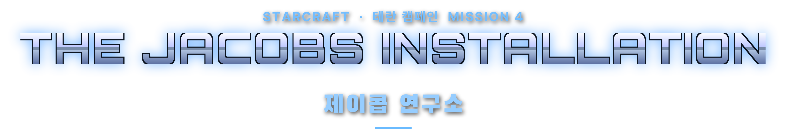
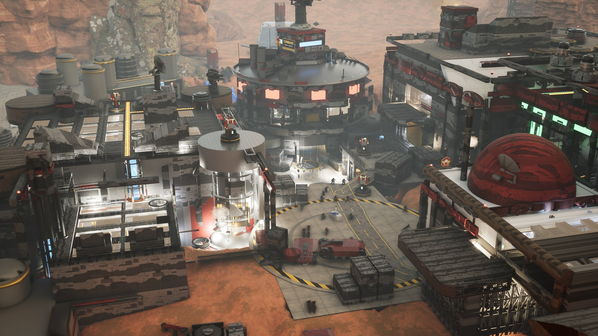
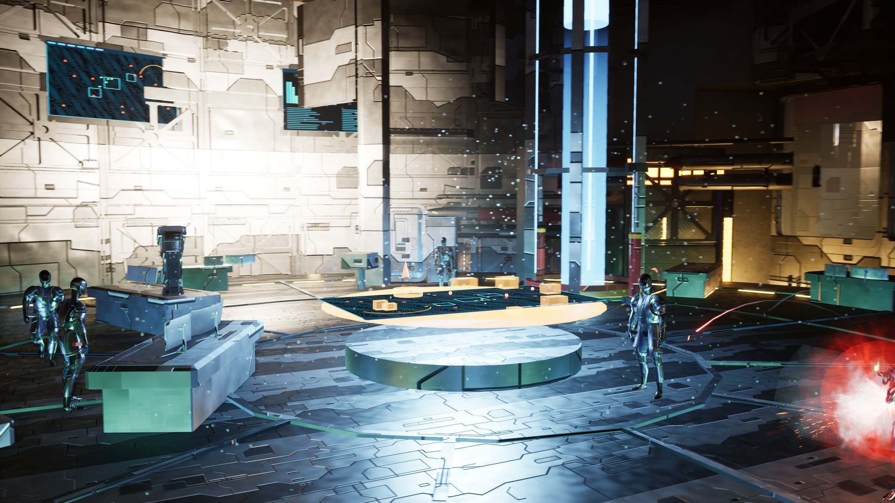
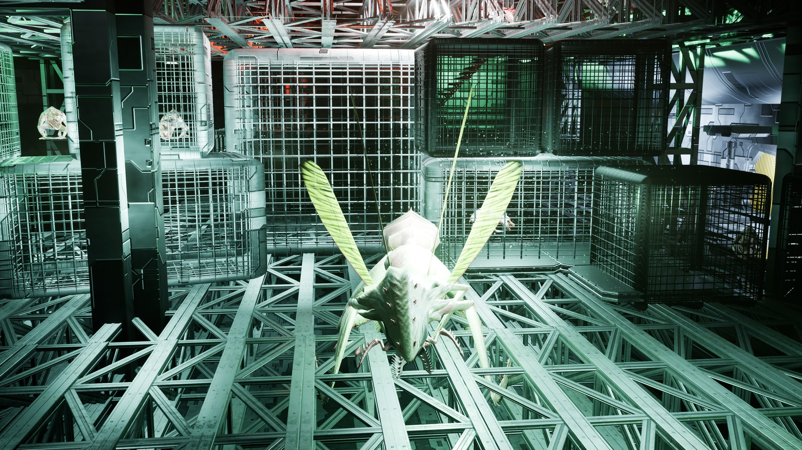
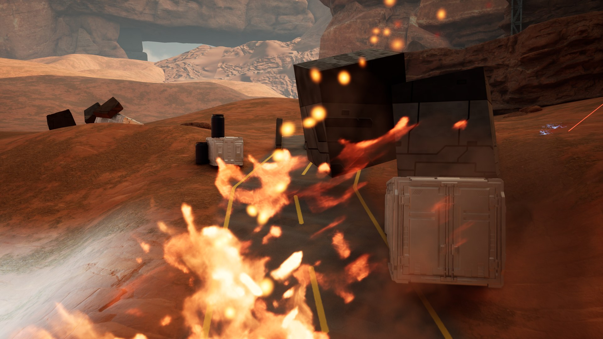
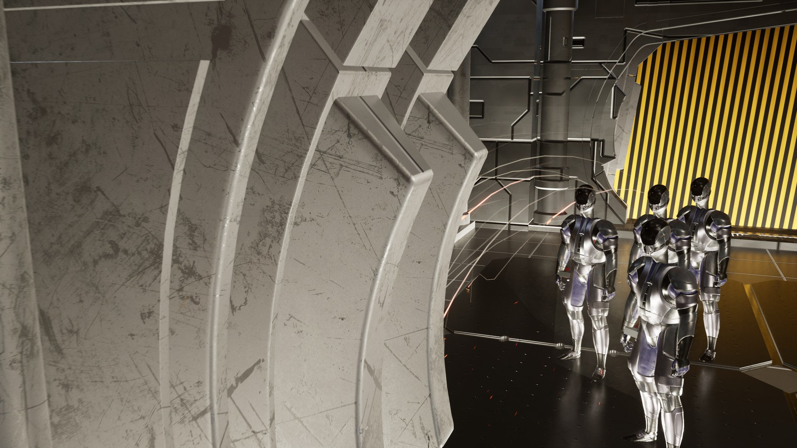
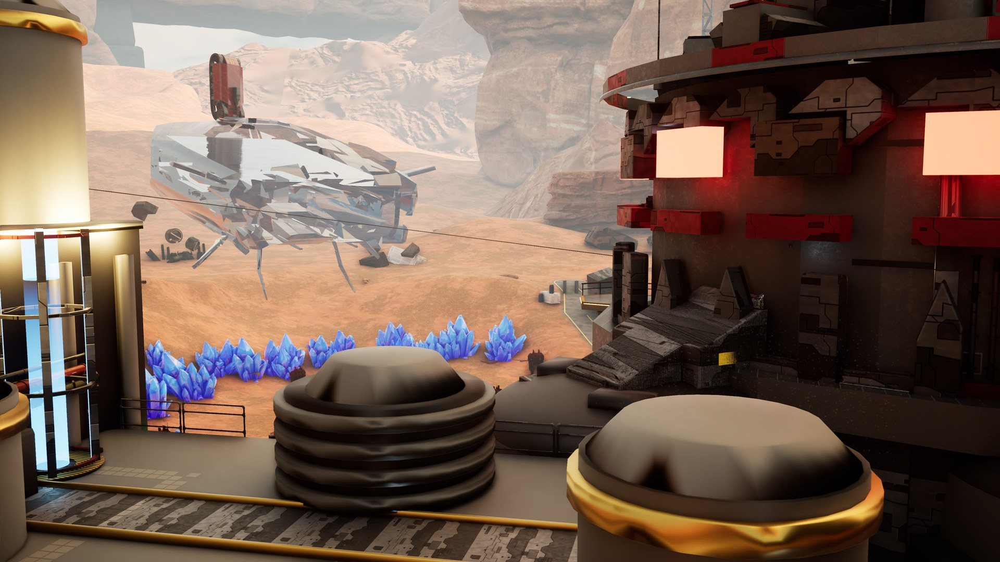

# THE JACOBS INSTALLATION — 3D 레벨 리디자인

**레벨 디자이너 손석완의 포트폴리오**입니다.
스타크래프트 테란 캠페인 4번 미션 **「제이콥 연구소 (The Jacobs Installation)」** 를 3인칭 잠입·슈팅 레벨로 리디자인하고, AI를 활용해 직접 플레이할 수 있는 빌드로 만들었습니다.

> 적이 드롭십으로 철수하는 혼란을 틈타 기지에 잠입해 무기 설계도를 빼내고, 폭격이 쏟아지는 기지를 가로질러 아군 드롭십으로 탈출하라.

## 영상

- 플레이 영상: (유튜브 링크 예정)

## 다운로드

[**Releases**](../../releases/latest) 에서 `JacobsInstallation_Win64.zip`(1.4 GB) 을 받아 압축을 풀고 `JacobsInstallation\portfolio.exe` 를 실행하세요.

## 권장 사양

- Windows 10/11 64비트, DirectX 12
- 그래픽: RTX 4070 SUPER 에서 4K 45–65 fps(업스케일 TSR) 확인. RTX 3060 급 이상 권장
- 저장 공간 약 1.6 GB
- 화면 모드·해상도(FHD/QHD/UHD)·프레임(60/40)은 타이틀의 **옵션** 또는 게임 중 **Esc** 메뉴에서 바꿀 수 있습니다.

## 조작

| 키 | 동작 |
|---|---|
| W A S D | 이동 |
| Shift | 달리기 |
| C | 웅크리기 |
| Space | 점프 |
| F | 상호작용 · 암살 |
| 마우스 오른쪽 / 왼쪽 | 조준 / 사격 |
| R | 재장전 |
| Esc | 일시정지 메뉴 (낙하 인트로 중에는 건너뛰기) |

## 스크린샷

| | |
|---|---|
|  |  |
|  |  |
|  |  |

## 만든 것

- 레벨 디자인: 원작 미션의 흐름(잠입 → 연구 시설 → 데이터 탈취 → 탈출)을 3D 공간으로 재구성. 옥상·지하 통로·리프트·짚라인으로 이어지는 잠입 동선, 경보 이후 폭격 속 탈출 구간
- 엔진: Unreal Engine 5.8 (C++)
- AI 활용: 게임플레이 코드·레벨 배치 스크립트·조명·사운드·영상 촬영 자동화를 AI(Claude) 와 함께 작업

## 고지

- StarCraft 및 관련 명칭·설정은 © Blizzard Entertainment 의 것입니다.
- 캐릭터: Paragon: Murdock (© Epic Games)
- 환경: Quixel Megascans (Fab), ModSci Interiors / Engineer / EngiProps
- 유닛 · 소품: Fab 무료 에셋 — 각 작가 (CC BY)
- 폰트: Orbitron · Rajdhani · Black Han Sans · Pretendard (SIL Open Font License)
